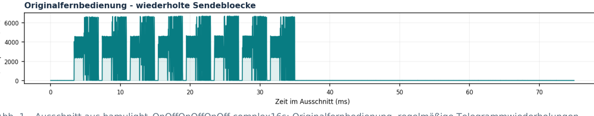
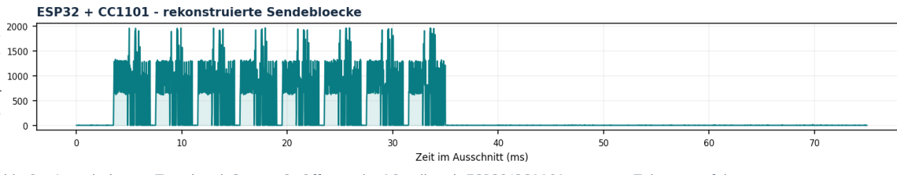
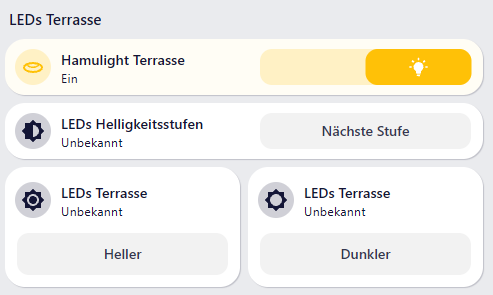

# Hamulight L2547-1 / L2564 – Funkprotokoll und ESPHome-Integration

**Reverse Engineering des 433-MHz-Funkprotokolls, Steuerung mehrerer Anlagen und Integration in Home Assistant**

**Autor:** Atilla Kati  
**Dokumentationsstand:** 11. November 2026  
**Status:** Anlage mit Senden, Empfangen und ON/OFF-Zustandsnachführung und Dimmen getestet

## 1. Zusammenfassung

Die originale Hamulight-Fernbedienung **L2547-1** steuert den LED-Treiber **L2564** per Funk. Das proprietäre Protokoll wurde mittels Nooelec NESDR SMArt v5 und Universal Radio Hacker (URH) untersucht und erfolgreich mit einem **diymore ESP32 LoRa V4.3 (ESP32-S3)** und externem **EBYTE CC1101** nachgebildet. Die neun vorhandenen 12-V-LED-Spots und der LED-Treiber bleiben unverändert. 

**Für die erste Anlage erfolgreich getestet:**

- Ein- und Ausschalten per ESPHome/CC1101.
- Heller- und Dunklerdimmen
- Zyklisches Durchschalten der vier Stufen **25 %, 50 %, 75 % und 100 %**.
- Empfang und Decodierung der originalen ON-/OFF-Fernbedienungstelegramme.
- Aktualisierung des ON-/OFF-Zustands in ESPHome und Home Assistant bei Verwendung der Originalfernbedienung.

**Erweiterung auf zwei Anlagen:** Die jüngste Vergleichsaufzeichnung mit zwei L2547-1-Fernbedienungen zeigt dieselbe Rahmenstruktur und denselben ON-Befehl, jedoch **unterschiedliche gerätespezifische Kennungsfelder**. Der Sender und Decoder wurden dafür konzeptionell bzw. in einer YAML-Teilkonfiguration auf zwei getrennte Anlagen vorbereitet. 

Eine **echte Statusbestätigung des LED-Treibers** und ein **absoluter Helligkeitswert über Funk** wurden bisher nicht nachgewiesen. Der angezeigte Schaltzustand ist der zuletzt erkannte oder selbst gesendete Befehl, kein vom Treiber quittierter Zustand.

## 2. Hardware und Verdrahtung

| CC1101 | Funktion | ESP32-S3 |
|---|---|---|
| GND | Masse | GND |
| VCC | 3,3 V | 3V3 |
| GDO0 | TX-Datenleitung | GPIO4 |
| CSN | SPI Chip Select | GPIO41 |
| SCK | SPI Clock | GPIO38 |
| MOSI | SPI MOSI | GPIO39 |
| MISO | SPI MISO | GPIO40 |
| GDO2 | RX-Datenleitung | GPIO6 |

### Funk- und SDR-Parameter

| Eigenschaft | Ermittelter bzw. verwendeter Wert |
|---|---|
| CC1101-Trägerfrequenz | 433,881 MHz (ESPHome-Konfiguration) |
| Modulation | ASK/OOK |
| Symbolcodierung | NRZ, MSB zuerst |
| Symbolrate | rund 30.000 Symbole/s |
| Symboldauer | ca. 33,3 µs |
| Empfangsfilterbandbreite | 203 kHz |
| TX/RX-Umschaltung | `cc1101.begin_tx` und `cc1101.begin_rx` |
| SDR-Aufnahme | URH, Center 433,500 MHz, 2 MS/s, ASK/NRZ, ca. 67 Samples/Symbol |

Der CC1101 arbeitet **halbduplex**. Während des Sendens ist kein zeitgleicher Empfang über denselben Funkbaustein möglich.

```yaml
cc1101:
  spi_id: led_spi
  cs_pin: GPIO41
  frequency: 433.881MHz
  modulation_type: ASK/OOK
  symbol_rate: 30000
  filter_bandwidth: 203kHz
  rx_attenuation: 0dB
  output_power: 10
```

Konfiguration der Empfang- und Sendeeinheit:

```yaml
remote_receiver:
  pin: GPIO6
  dump: []
  filter: 10us
  idle: 5ms
  use_dma: true
  rmt_symbols: 1024
  receive_symbols: 1024
  buffer_size: 16kB
  on_raw:
    then:
      - script.execute:
          id: hamulight_receive
          # Auf ESP32-S3 ist x std::vector<long>, int[] erwartet std::vector<int>.
          raw: !lambda 'return std::vector<int>(x.begin(), x.end());'

remote_transmitter:
  id: hamulight_tx
  pin: GPIO4
  carrier_duty_percent: 100%

  on_transmit:
    then:
      - logger.log:
          format: "HAMULIGHT: CC1101 wechselt in TX"
          level: WARN
          tag: hamulight
      - cc1101.begin_tx

  on_complete:
    then:
      - cc1101.begin_rx
      - logger.log:
          format: "HAMULIGHT: CC1101 zurueck in RX"
          level: WARN
          tag: hamulight
```


## 3. Signalanalyse und Timing

Die beiden folgenden Abbildungen stammen aus der hochgeladenen Messdokumentation. Die dargestellten IQ-Amplituden sind relativ, nicht leistungs-kalibriert.



*Abb. 1 – Originalfernbedienung: zeitlich wiederholte Telegramme.*



*Abb. 2 – Rekonstruierte Übertragung mit ESP32/CC1101.*

| Merkmal | Beobachtung |
|---|---|
| Nutzbare vollständige Bitfolge | 208 Bit |
| Telegrammdauer | ca. 6,93 ms |
| Abstand zweier Telegrammstarts | ca. 8,03 ms |
| Telegramme pro Befehlsgruppe | 8 identische Wiederholungen |
| Gehaltene ON-/OFF-Taste | etwa alle 167 ms neue Gruppe mit inkrementiertem Counter |

Frühere Kontrolltests verifizierten unabhängig die Sendezeitbasis anhand künstlicher 400-µs- und 33-µs-Pulse.

## 4. Rekonstruiertes Telegrammformat

### 4.1 Rahmen

| Bitposition | Länge | Inhalt |
|---|---:|---|
| 0–79 | 80 Bit | Präambel `0xAA` × 10 |
| 80–95 | 16 Bit | Synchronisationswort `0x2D 0xD4` |
| 96–207 | 112 Bit | 14 maskierte Nutzdatenbytes (MSB zuerst) |

### 4.2 Abstrakte Nutzdatenstruktur

Die **14 Bytes vor der XOR-Maskierung** besitzen in den analysierten Nachrichten diese Form:

```text
[HEADER_0] [HEADER_1] [COUNTER_BASE]
[DEVICE_ID_HIGH] [DEVICE_ID_LOW]
[PROTOCOL_FIELD] [COMMAND]
[RESERVED_0] [RESERVED_1] [RESERVED_2]
[RESERVED_3] [RESERVED_4] [RESERVED_5]
[CHECKSUM]
```

Die nicht gerätespezifischen Konstanten im Basisformat sind:

- `HEADER_0 = 0xAA`, `HEADER_1 = 0x02`, `COUNTER_BASE = 0x00`.
- `PROTOCOL_FIELD = 0x01`; die sechs reservierten Bytes sind in den untersuchten Telegrammen `0x00`.
- Die **zwei `DEVICE_ID_*`-Bytes** unterscheiden die Anlagen. Ihre konkreten Werte sind in dieser Dokumentation bewusst nicht enthalten.
- Das Prüfsummenbyte entsteht durch bitweises XOR der **ersten 13 unmaskierten Nutzdatenbytes**. Deshalb hängt die Prüfsumme **auch von der jeweiligen Gerätekennung** ab; eine für alle Anlagen feste Formel `CRC = Konstante XOR COMMAND` wäre falsch.
- Alle **14 Datenbytes einschließlich der Prüfsumme** werden anschließend mit demselben **8-Bit-Telegrammzähler** byteweise XOR-maskiert. Aus dem dritten übertragenen Nutzdatenbyte lässt sich der Counter bestimmen, weil dessen unmaskierter Ausgangswert `0x00` ist.

Die semantische Zuordnung wurde durch Vergleich der URH-Aufnahmen und praktische Tests erschlossen; es handelt sich **nicht** um eine veröffentlichte Herstellerspezifikation.

### 4.3 Decodierte Commands

| Command | Funktion | Validierung an Anlage 1 |
|---|---|---|
| `0x01` | Einschalten | Erfolgreich getestet |
| `0x02` | Ausschalten | Erfolgreich getestet |
| `0x10` | Nächste Helligkeitsstufe | Erfolgreich getestet |
| `0x20` | Heller dimmen | Erfolgreich getestet |
| `0x21` | Dunkler dimmen | Erfolgreich getestet |

**Betriebsverhalten:** Der Treiber muss zunächst mit ON eingeschaltet werden; erst dann wirken Dimmbefehle und Stufenwechsel. Der mittlere Fernbedienungstaster überträgt immer denselben Stufenwechsel-Command, keine vier unterschiedlichen absoluten Stufen-Commands.

## 5. Vergleich zweier Fernbedienungen und Anlagen

Die zusätzliche URH-Aufzeichnung `Hamulight_2xOn_2xL2547-1.complex16s` mit zugehörigem `.proto` enthält **vier kurze ON-Betätigungen von zwei Fernbedienungen**. Je Betätigung wurden acht gleiche Telegramme beobachtet.

| Eigenschaft | Anlage A | Anlage B |
|---|---|---|
| Funkrahmen | Gleiches 208-Bit-Format | Gleiches 208-Bit-Format |
| Präambel und Sync | Gleich | Gleich |
| ON-Command | `0x01` | `0x01` |
| Gerätekennung | Eigenständig, nicht abgedruckt | Eigenständig, nicht abgedruckt |
| Counter | Fortlaufend je Fernbedienung | Fortlaufend je Fernbedienung |
| Prüfsumme | Kennungsabhängig, gültiges XOR-Format | Kennungsabhängig, gültiges XOR-Format |
| Praktischer ESP32-Sendetest | Erfolgreich | Noch ausstehend |

Die Analyse legt nahe, dass ein gemeinsamer CC1101 beide Anlagen anhand des Kennungsfeldes adressieren kann. 

## 6. ESPHome-Architektur für zwei Anlagen

### 6.1 Senden

Das bestehende Script `hamulight_send` erhält die Parameter `device`, `command` und `groups`:

```yaml
script:
  - id: hamulight_send
    mode: queued
    parameters:
      device: int
      command: int
      groups: int
    # Generator und Sendeaktionen bleiben Teil der lokalen ESPHome-Konfiguration.
```

Zur Laufzeit wird die zur gewählten Anlage gehörige **lokal konfigurierte Gerätekennung** eingesetzt. Der Encoder bildet den gültigen 208-Bit-Frame, berechnet die kennungsabhängige XOR-Prüfsumme, maskiert die Nutzdaten mit dem Counter und sendet jede Gruppe achtmal.

Für zwei Anlagen sind getrennte Zählervariablen vorgesehen (`hamulight_counter_1` und `hamulight_counter_2`). Das bestehende gemeinsame Sendemodul wird über eine wartende Ausführungsfolge (`mode: queued`) serialisiert. Beim Dimmen folgen mehrere Gruppen mit erhöhtem Counter in einem Abstand in der Größenordnung von 167 ms.

### 6.2 Empfangen

`remote_receiver.on_raw` übergibt die empfangenen RMT-Laufzeiten an `hamulight_receive`. Auf dem verwendeten ESP32-S3 war eine explizite Vektortypkonvertierung nötig:

```yaml
remote_receiver:
  # bestehende Pin-/RMT-Konfiguration
  on_raw:
    then:
      - script.execute:
          id: hamulight_receive
          raw: !lambda |-
            return std::vector<int>(x.begin(), x.end());
```

Das Empfangsscript:

1. Wandelt die Laufzeiten in NRZ-Bits um.
2. Sucht nach Präambel und Sync.
3. Liest die 14 Nutzdatenbytes und entfernt die Counter-XOR-Maskierung.
4. Prüft Basisformat, reservierte Bytes und XOR-Prüfsumme.
5. Vergleicht die **lokal hinterlegte Gerätekennung** mit Anlage A bzw. Anlage B.
6. Ordnet gültige ON-/OFF-Commands dem jeweiligen ESPHome-Zustand zu.

**Wichtig:** Empfangene Telegramme werden nur per `publish_state()` gespiegelt; sie sollen **nicht** erneut gesendet werden. Anderenfalls drohen Rückkopplung und unnötiger Funkverkehr.

### 6.3 Zustand und Home Assistant

| Logischer Baustein | Anlage A | Anlage B |
|---|---|---|
| Sendecounter | `hamulight_counter_1` | `hamulight_counter_2` |
| ON/OFF-Status | `hamulight_power_1` | `hamulight_power_2` |
| Native Lichtentität | `hamulight_light_1` | `hamulight_light_2` |
| Heller/Dunkler | Separate Aktionen | Separate Aktionen |
| Nächste Stufe | Separater Button | Separater Button |

Für Home Assistant ist je Anlage eine **native binäre ESPHome-Lichtentität** ohne Helligkeitsschieberegler sinnvoll. Die Bedienfunktionen Heller, Dunkler und Nächste Stufe bleiben getrennte Aktionen. Die UI sollte diese Aktionen bei ausgeschaltetem Licht ausblenden oder deaktivieren; auch der ESP32 sollte Dimm-/Stufenbefehle für ausgeschaltete LEDs nicht auslösen.




Der binäre Lichtzustand wird vom ESP32 aus **empfangenen bzw. lokal ausgelösten ON-/OFF-Befehlen** nachgeführt. **Es liegt keine aktive Quittierung des LED-Treibers vor.** Fremde Sender, Paketverlust, Funkkollisionen, Stromausfall oder Bedienung während eines CC1101-Sendevorgangs können die Zustandsanzeige entkoppeln.

## 7. Validierung und offene Punkte

| Prüfpunkt | Stand |
|---|---|
| Anlage A: ON/OFF über ESP32/CC1101 | **Bestätigt** |
| Anlage A: Heller/Dunkler per ESP32 | **Bestätigt** |
| Anlage A: zyklischer Stufenwechsel | **Bestätigt** |
| Anlage A: Originalfernbedienung per RX decodiert | **Bestätigt** |
| Anlage A: ON/OFF-Nachführung in HA | **Bestätigt** |
| Zweite Fernbedienung: Protokoll-/Kennungsunterschied im SDR | **Analysiert** |
| Zwei Anlagen: getrennte Zuordnung von Sender und Decoder im ESPHome-Code | **Vorbereitet; nicht vollständig praktisch getestet** |
| Anlage B: ESP32-ON/OFF am LED-Treiber | **Test ausstehend** |
| Anlage B: Dimmen und Stufenwechsel | **Test ausstehend** |
| Native Lichtentität für beide Anlagen im HA-Betrieb | **Noch nicht als Gesamtsystem bestätigt** |
| Echte Treiber-Rückmeldung oder absolute Helligkeit | **Nicht nachgewiesen** |

### Noch zu untersuchen

- Zählerüberlauf bei `0xFF` und Verhalten nach Neustart/Stromverlust.
- Counter-Verhalten bei paralleler Nutzung von ESP32 und zwei Originalfernbedienungen.
- Eindeutige Zuordnung der physischen Fernbedienungen und LED-Treiber beim späteren Anlage-B-Test.
- Verhalten bei zeitlich überlappenden Funkkommandos und Reichweite am endgültigen Montageort.
- Eine tatsächliche Helligkeitsrückmeldung des L2564 ist nicht bekannt. Die vier Stufen werden treiberseitig zyklisch verwaltet, nicht als absoluter Sollwert übertragen.

## 8. Messdaten und Reproduzierbarkeit

| Aufnahme | Zweck |
|---|---|
| `hamulight_3x_on_01.complex16s`, `hamulight_3x_off_01.complex16s` | Frühe ON-/OFF-Analyse |
| `hamulight_OnOffOnOffOnOff.complex16s` und `.proto` | Abwechselnde ON-/OFF-Kommandos |
| `Testsignal_2.complex16s` | Zeitbasis-/Pulstest |
| `Testsignal_CustomOnOff.complex16s`, `Custom_OnOff.proto` | Per ESP32 generierte ON-/OFF-Frames |
| `Dimmtest_ON.complex16s` und `.proto` | Langer ON-Tastendruck / Heller |
| `Dimmtest_OFF.complex16s` und `.proto` | Langer OFF-Tastendruck / Dunkler |
| `Dimmtest_ON-OFF_short.complex16s` und `.proto` | Vergleich kurzer Tastendrücke |
| `Hamulight_4_Stufen.complex16s` und `.proto` | Zyklische Helligkeitsstufen |
| `Hamulight_2xOn_2xL2547-1.complex16s` und `.proto` | Vergleich zweier originaler Fernbedienungen |


## 9. KI-Unterstützung

Die Entwicklung und Dokumentation dieses Projekts erfolgten mit Unterstützung von **ChatGPT (OpenAI)**.
Die KI wurde insbesondere bei der Analyse und Interpretation der aufgezeichneten Funktelegramme, der Rekonstruktion des Funkprotokolls, der Implementierung der ESPHome-Komponenten eingesetzt.
Die Hardwareintegration, die Durchführung der Messungen, die praktischen Funktionstests und die Validierung der Ergebnisse erfolgten durch den Autor.

## 10. Herkunft und Grenzen

Die Dokumentation beschreibt **Reverse-Engineering-Ergebnisse** und ist keine offizielle Hamulight-Protokollspezifikation. Der bislang erreichte Betriebsnachweis gilt ausdrücklich für Anlage A.

---

**Autor:** Atilla Kati  
**Geräte:** Hamulight L2547-1 / L2564 · ESP32-S3 · CC1101 · ESPHome · Home Assistant  
**Stand:** 11. November 2026
